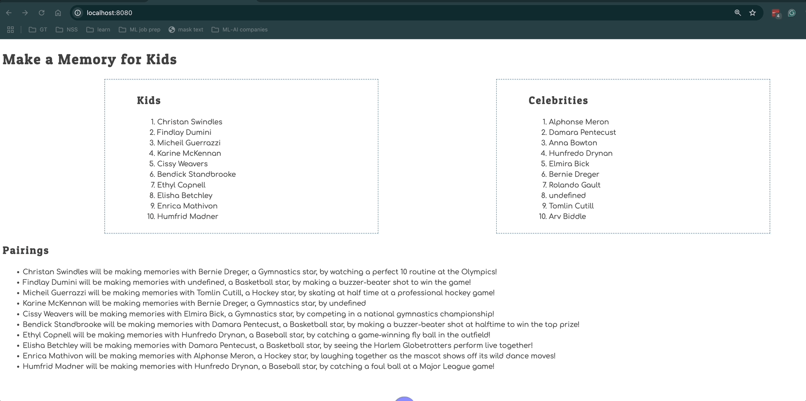

# Events and Debugging Assessment

Time to assess how well you have learned to use the debugging tools in Chrome Dev Tools, and writing click event listeners. This application is to show kids with illnesses and the memories the would like to make. Celebrities sign up to help kids make memories.

> 🧨 Make sure you answer the vocabulary and understanding questions at the end of this document before notifying your coaches that you are done with the project

## Event Listeners to Create

1. When the kid name is clicked, it should display their wish.
1. When the celebrity name is clicked, it should display their sport.
1. The pairings list should should contain the pairing in the following format.
   ```html
   {child name} will be making memories with {celebrity name}, a {celebrity
   sport} star, by {child wish}
   ```

Below is an animation showing how the application should look when complete and how the event listeners should work.



## Setup

Your instruction team will provide a link for you to create your assessment repository. Once your repo is created, clone it to your machine.

1. Make sure you are in your `workspace` directory.
1. `git clone {github repo SSH string}`.
1. `cd` into the directory it creates.
1. `code .` to open the project code.
1. Use the `serve` command to start the web server.
1. Open the URL provided in Chrome.

Make sure your Developer Tools are open at all times while working on this project. Use the messages provided in the Console to determine what code needs to be fixed or implemented, and use breakpoints in the Sources tab to step through your code as you debug.

## Vocabulary and Understanding

Before you click the "Complete Assessment" button on the Learning Platform, add your answers below each question and make a commit.

1. When a child is clicked on in the browser, which module contains the code that will execute on that event happening? Can you explain the algorithm of that logic?
   > The event listener in my children.js module contains that logic. In the addEventListener code, first the event established as a "click". Then, (onClick) is defined as a function in which, the click's target is stored in the variable, "clickedItem". An 'if' statement is established providing the condition of 'if (clickedItem.dataset.type === "child")'. This checks for the type in the dataset associated with the click's target/clickedItem. In the children.js module, all of the keys of the "children" objects from the database are noted as metadata in the html that is created by the Children function. Because each list item created by the Children function will include the 'data-type="child"' metadata, my if statement will trigger a function whenever a child's name is clicked. The function that runs is the 'window.alert' which displays the text of the template literal housed in a small notification/message window in the browser. The string in the window.alert pulls multiple pieces of information to create unique srtings for each child's name available to be clicked on by the user. The pieces of information, specifically the child's name and the child's wish, come from each list item's unique metadata.
2. In the **Pairings** module, why must the `findCelebrityMatch()` function be invoked inside the `for..of` loop that iterates the kids array?
   > Firslty, I changed the name of the 'kids' array to 'children'. :) ... The parameters of the 'findCelebrityMatch' function are 'child' and 'celebrities', in that order. While 'children' and 'celebrities' are both variables defined earlier on in the code which pull the 'children' and 'celebrities' arrays from the database module, 'findCelebrityMatch' needs to iterate over one child object at a time in order to compare each child object's 'celebrityId' key in order to match the child to their celebrity. The for loop is needed to perform that iteration. If 'findCelebrityMatch' was called outside of that loop, there would be no individual child objects to serve as arguments for the 'child' parameter of the function.
3. In the **CelebrityList** module, can you describe how the name of the sport that the celebrity plays can be displayed in the window alert text?
   > (celebrities.js = CelebrityList.js)... This is done in the same way that is seen in the 'pairings.js' module - using an event listener for any 'click' event. The 'database' module contains a 'celebrities' array, and I stored the keys of the objects in the 'celebrities' array as metadata in the celebrityHTML that is created by the Celebrities function. The event listener in the 'celebrities' module listens for the type of 'celebrity', and then generates a string/template literal that pulls the sport from the same metadata, as 'sport' is one of the keys found in each celebrity object in the database.
4. Can you describe, in detail, the algorithm that is in the `main` module?
   > How much detail?? lol ..... Outside of the 'main' module, in 'index.html', an ID of "container" is established in the body of the html. In 'main.js', the variable, 'mainContainer', is defined basically as that container (more like it locates anything ID'ed as 'container' within the DOM). Then, the variable, 'applicationHTML' is defined and houses an html framework in which one article, containing two sections with the class 'detail--column...', is established, followed by another article containing its own section with the class 'detail--row...'. The first article displays a row of information with the first section calling in the list of children's names and the relative event listener + click-event window alert info, both from 'children.js' (via the exported/imported 'Children()' function). The second section in the first article does the same, but for celebrities via the 'Celebrities()' function. The second article block on 'main.js' pulls the strings created by the 'Pairings()' function. Following my applicationHTML variable, I have mainContainer.innerHTML = applicationHTML which establishes all the html generated by the applicationHTML constant as the HTML data that will become the "inner html" housed within <main></main> since <main> is ID'ed as the DOM's container. The implanted html becomes what is seen when the index page loads on the browser.
